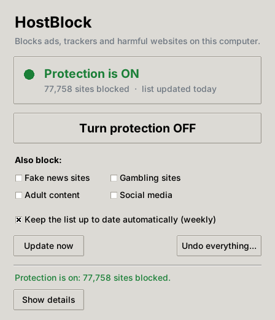

# HostBlock

Blocks ad, tracking and malware domains system-wide by adding
[StevenBlack's unified hosts list](https://github.com/StevenBlack/hosts) (about 78,000 domains)
to your hosts file. Before it changes anything, it saves an exact copy of your original hosts
file so you can undo the change completely.

- Ways to use it:
  - **`Hostblock.setup.exe`**, a Windows installer with a setup wizard. Nothing else is needed,
    not even Python.
  - **`HostBlock.pyw`**, a simple window for everyday use;
  - **`hostblock.py`**, the command-line tool that does the work. Keep both files in the same
    folder.
- Without the installer, it needs **Python 3.8+** and has no other dependencies.
- It works on Windows, macOS and Linux.
- Your existing hosts entries are never changed. The blocklist goes into a marked section:

  ```
  # >>> HOSTBLOCK START - managed by hostblock.py - do not edit inside this section >>>
  0.0.0.0 ads.example.com
  ...
  # <<< HOSTBLOCK END <<<
  ```

## Windows: install with the setup wizard

Run **`Hostblock.setup.exe`** and follow the wizard. It works on Windows 10 and 11 (64-bit).

1. **Welcome:** explains what HostBlock does.
2. **Choose your protection:**
   - Turn on protection right away (on by default).
   - Optionally also block fake news, gambling, adult content or social media sites.
   - Keep the list updated weekly (on by default).
   - Create a desktop shortcut.
3. **Installing:** copies HostBlock to `C:\Program Files\HostBlock`, downloads the latest list
   and applies your choices.
4. **Finish:** tells you whether protection is on and offers to open the HostBlock window.

Notes:

- **Bundled Python:** HostBlock comes with its own private copy of Python. It doesn't touch, or
  need, any Python you may already have.
- **"Windows protected your PC" warning:** the installer isn't code-signed, so SmartScreen may
  show this. Click **More info**, then **Run anyway**. To remove the warning, sign the installer
  with a code-signing certificate.
- **Running setup again:** this upgrades or repairs HostBlock and keeps your original hosts
  backup.
- **Uninstalling:** use **Settings → Apps → HostBlock → Uninstall**. The uninstaller puts your
  hosts file back exactly as it was before HostBlock, removes the weekly update, and deletes
  everything it installed.
- **Silent install for IT admins:** `Hostblock.setup.exe /S`, optionally with `/NOPROTECT`,
  `/NOWEEKLY` or `/NODESKTOP`. Silent uninstall:
  `"C:\Program Files\HostBlock\Uninstall.exe" /S`.

### Building the installer yourself

```bash
python3 installer/build.py        # -> dist/Hostblock.setup.exe
```

The build needs NSIS 3 (`makensis`) and zstd:
- Debian/Ubuntu: `sudo apt install nsis zstd`
- macOS: `brew install makensis zstd`
- Windows: NSIS from nsis.sourceforge.io

`build.py` downloads a pinned Python runtime and checks every file against a SHA-256 hash:
- **Python 3.14.10:** the official NuGet package, published by the Python Software Foundation;
- **Tkinter and Tcl/Tk 8.6:** from conda-forge, because the NuGet package leaves them out and the
  window needs them.

Pip, the test suite and other unused parts are left out, so the installer is about 10 MB.
The wizard's script is `installer/HostBlock.nsi`; its artwork comes from
`installer/make_assets.py`.

## The easy way: the HostBlock window



### How to open it

- **Windows:** use the installer above. It adds HostBlock to the Start menu, and Windows asks
  for permission each time you open it. Without the installer, double-click
  **`HostBlock.pyw`** (this needs Python from python.org).
- **macOS:** double-click **`HostBlock.command`**. The first time, macOS may refuse to open a
  downloaded file; if so, right-click it and choose **Open**. Python from
  [python.org](https://www.python.org/downloads/) is recommended, because Apple's built-in Python
  has an outdated window toolkit. You'll be asked for your Mac password each time you make a
  change.
- **Linux:** run `python3 HostBlock.pyw`. It needs the `python3-tk` package, which on
  Debian/Ubuntu you install with `sudo apt install python3-tk`. Your desktop asks for your
  password when you make a change.

### What's in the window

- **Turn protection ON / OFF:** the one button most people need. Turning it on downloads the
  latest list, which takes a few seconds.
- **Also block:** tick fake news, gambling, adult content or social media. If protection is
  already on, click **Apply changes** afterwards.
- **Keep the list up to date automatically (weekly):** leave this ticked and the list refreshes
  itself every Sunday. See [Weekly auto-update](#weekly-auto-update).
- **Update now:** gets the newest list immediately.
- **Undo everything:** puts your computer back exactly as it was before HostBlock, and removes
  the weekly update.
- **Show details:** shows exactly what happened, which is useful if something goes wrong.

The window doesn't change anything itself. Every change is made by `hostblock.py` with
administrator rights, so the same backups and safety checks apply.

## Running it with Administrator / root privileges

The hosts file and the system scheduler are protected, so every command except `status` must run
elevated. `status` and `--dry-run` work as a normal user. If you forget, the script stops without changing
anything and prints the exact command to run.

### Windows

1. Click **Start** and type `cmd`.
2. Right-click **Command Prompt** and choose **Run as administrator**, then click **Yes**.
3. Go to the folder that holds the script and run it:

   ```bat
   cd /d C:\path\to\hostblock
   python hostblock.py block
   ```

If you'd rather stay in a normal prompt, `--elevate` makes the script open the UAC prompt
itself. The work then runs in a new Administrator window, which stays open until you press Enter:

```bat
python hostblock.py --elevate block
```

Double-clicking `hostblock.py` opens the interactive menu, which also offers to relaunch as
Administrator.

### macOS / Linux

```bash
sudo python3 hostblock.py block
```

## Commands

| Command | What it does |
|---|---|
| `block` | Downloads the latest list and adds the blocked section. Running it again **updates** the section. |
| `unblock` | Removes **only** the HostBlock section. Any edits you made to the hosts file in the meantime are kept. |
| `restore` | Puts back the **exact** original hosts file (byte for byte) from the backup taken before the first `block`, and removes the weekly task. |
| `update` | Re-downloads the list using the current source and options. This is what the weekly task runs. |
| `schedule` | Installs a weekly auto-update task (default: Sunday 10:30). See below. |
| `unschedule` | Removes the weekly auto-update task. |
| `status` | Shows whether blocking is active, how many domains are blocked, when the list was last updated, and whether auto-update is on. |
| *(none)* | Opens the interactive menu. Option 5 turns auto-update on or off. |

Useful options:

```bash
sudo python3 hostblock.py block --dry-run                       # preview only, writes nothing
sudo python3 hostblock.py block --allow doubleclick.net         # never block a domain (and its subdomains)
sudo python3 hostblock.py block --extensions fakenews gambling  # also block these StevenBlack categories
sudo python3 hostblock.py block --compact                       # 9 domains per line (recommended on Windows)
sudo python3 hostblock.py block --schedule                      # also turn on the weekly auto-update
sudo python3 hostblock.py block --url https://example.org/my-hosts-list
```

The available `--extensions` are `fakenews`, `gambling`, `porn` and `social`.

## Weekly auto-update

StevenBlack's list changes several times a week. One command registers a weekly refresh with your
operating system's own scheduler:

```bash
sudo python3 hostblock.py schedule                          # every Sunday at 10:30
sudo python3 hostblock.py schedule --day wed --time 18:45   # pick your own slot
```

On Windows, run `python hostblock.py schedule` from an Administrator Command Prompt (or add
`--elevate`).

| OS | Scheduler used | If the computer is off at that time |
|---|---|---|
| Windows | Task Scheduler task **HostBlock Weekly Update**, run as SYSTEM | Runs soon after the next start-up |
| macOS | launchd job `/Library/LaunchDaemons/com.hostblock.update.plist` | Runs on wake if the Mac was asleep |
| Linux (systemd) | `hostblock-update.timer` with `Persistent=true` | Runs soon after the next boot |
| Linux (no systemd) | `/etc/cron.d/hostblock` | Skipped until the next week |

How it behaves:

- **It keeps your settings.** Each run executes `update`, which re-applies the same source,
  `--extensions`, `--compact` and `--allow` choices you last used with `block`. These are stored in
  the hosts file's HostBlock header.
- **It respects "off".** After `unblock`, the weekly run does nothing until you `block` again.
  `restore` removes the task completely, and `unschedule` removes it at any time.
- **A bad download can't break anything.** If the download fails or doesn't look like a valid
  list, the hosts file is left as it was.
- **It's logged.** Each run is appended to `/var/log/hostblock.log`, or
  `C:\ProgramData\HostBlock\hostblock.log` on Windows.
- **It runs a protected copy of the script.** A task that runs with admin rights must not run a
  file your normal account can edit, such as one in Downloads: anything running as you could
  change it and gain admin rights. So `schedule` copies `hostblock.py` into an admin-only folder
  and runs that copy with `python -I`:
  - Linux: `/usr/local/lib/hostblock/`
  - macOS: `/Library/Application Support/HostBlock/`
  - Windows: `C:\Program Files\HostBlock\`

  After you update `hostblock.py`, run `schedule` again to refresh the copy. The script also warns
  you if the Python interpreter itself sits in a folder your user can change (a virtualenv,
  pyenv, Homebrew, or a "just for me" Python install on Windows).
- **Microsoft Store Python** can't run as SYSTEM. With it, the task runs as you (with admin
  rights) while you're signed in. A python.org install with "Install for all users" avoids this
  limit.

Check that it's active with `python3 hostblock.py status`, which shows an `Auto-update : ON - …`
line.

## How undo works

The backups are kept next to the hosts file (on Windows, the hosts file is
`C:\Windows\System32\drivers\etc\hosts`):

- **`hosts.hostblock-original`** is written once, right before the first `block`. Later updates
  never overwrite it. `restore` copies it back and then deletes it, because the hosts file is
  original again. `unblock` also deletes it: the file is then back to your own entries, and the
  next `block` takes a fresh backup.
- **`hosts.hostblock-previous`** is the state just before the most recent change. It is a safety
  net if you ever need to undo an `unblock` or `restore`.

To return to exactly what you had before, run `restore`. It also removes the weekly
auto-update task and its installed files, so nothing HostBlock added is left behind. To stop
blocking but keep any changes you made to the hosts file since, run `unblock`.

## Safety checks on the downloaded list

The script doesn't trust the download blindly:

- It downloads over **HTTPS only**, with certificate verification. Plain-HTTP URLs and redirects
  to plain HTTP are refused.
- Only **block entries** are accepted: `0.0.0.0`, `127.0.0.1`, `::` or `::1`. A line that maps a
  domain to a real IP address (for example `6.6.6.6 yourbank.com`) is rejected. A tampered list
  can therefore block sites but never redirect them.
- Every domain name is syntax-checked. System names (`localhost`, `broadcasthost`, …) are never
  imported.
- Domains that already appear in your hosts file are skipped, so your own entries always win.
- If fewer than 1,000 valid domains come back (for example, an error page instead of the list),
  the script aborts and changes nothing.
- The hosts file is rewritten in place, which keeps its owner, permissions, Windows ACLs and
  SELinux labels. After writing, the script reads the file back to confirm it saved correctly.

StevenBlack does not publish signatures for the list. These checks limit what a bad download
could do, but they can't prove the list is authentic.

## Notes and troubleshooting

- **The DNS cache** is flushed automatically: `ipconfig /flushdns` on Windows,
  `dscacheutil`/`mDNSResponder` on macOS, and `resolvectl` or `nscd` on Linux when present. Use
  `--no-flush` to skip this. Browsers keep their own short-lived DNS cache, so restart the browser
  if a site still loads ads.
- **On Windows, use `--compact`.** It cuts the line count about ninefold, and the Windows DNS
  Client handles very large hosts files poorly.
- **Microsoft Defender or other antivirus** may flag hosts file changes (for example
  `SettingsModifier:Win32/HostsFileHijack`). That alert is a reaction to this change. Allow it in
  Defender, or run `unblock` / `restore`.
- **If a site breaks**, re-run `block` with `--allow thatdomain.com`, or run `unblock`.
- **To keep the list fresh**, use `schedule` (see [Weekly auto-update](#weekly-auto-update)), or
  run `update` by hand whenever you like.
- **Certificate errors behind a corporate proxy:** point Python at your company's CA bundle, for
  example `SSL_CERT_FILE=/path/to/ca.pem`.
- **Testing without touching the real file:**
  `python3 hostblock.py --hosts-file ./test-hosts block` needs no admin rights if you own the file.
